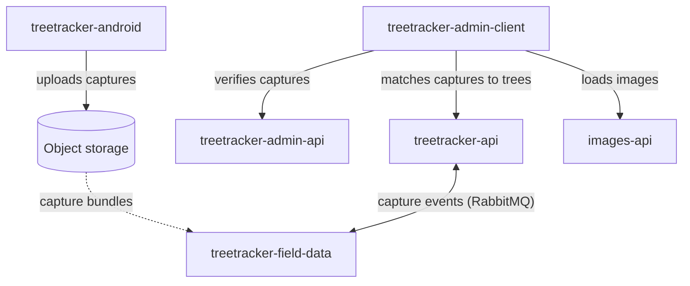
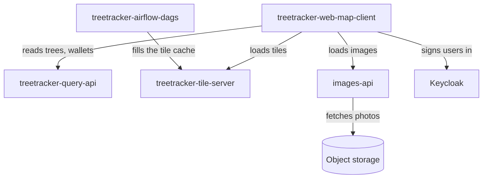
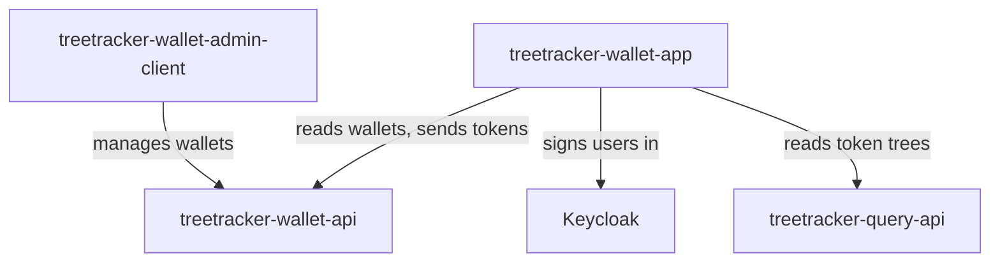
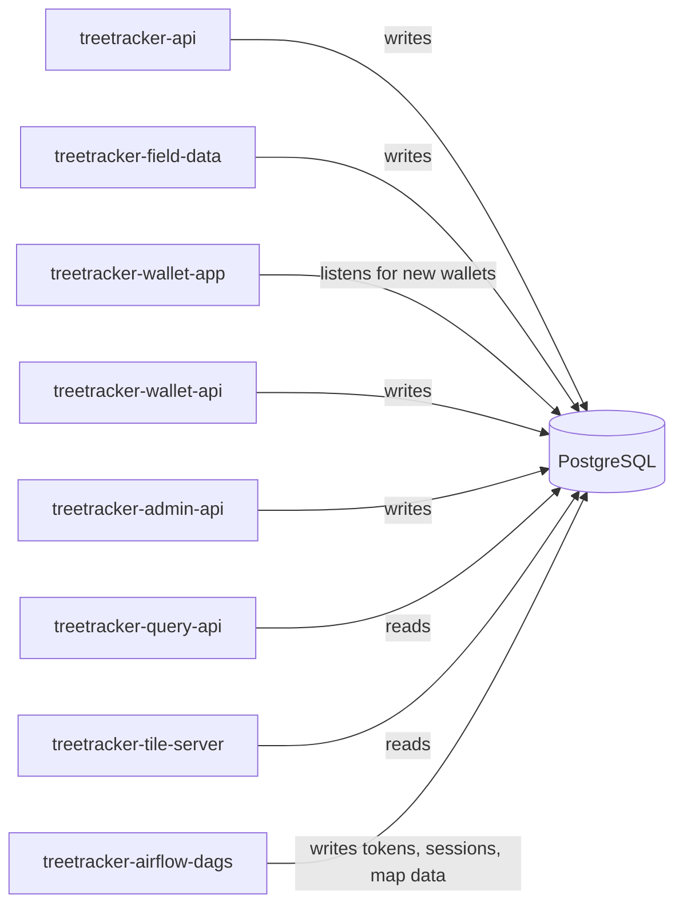
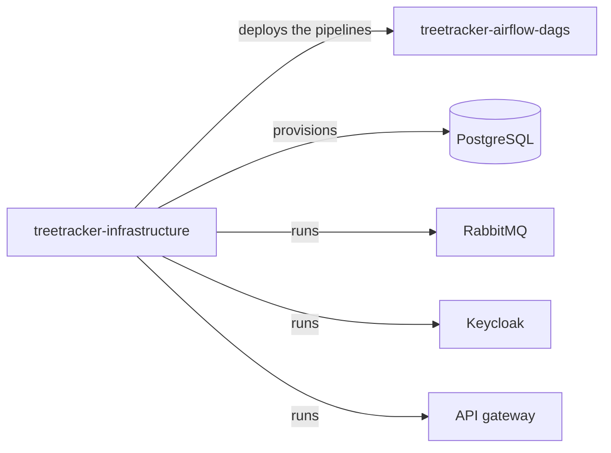

# How the Greenstand repos work together

These maps show how the 14 code repos of the estate work together at run time. A code repo is a
source repo that holds code. The maps show the main calls and the shared systems. They do not
show every call. The last map shows the platform that the code repos run on. To learn about
Greenstand itself, start with
[Greenstand-Overview](https://github.com/Greenstand/Greenstand-Overview) and
[How to contribute to Greenstand](./docs/contribute-to-greenstand.md).

How to read the maps:

- An arrow points from the repo that uses something to the repo or the system that it uses.
- A dotted arrow comes from the docs of a repo, not from its code.
- A cylinder is a store of data.

## Capture and verification

A grower uses the Treetracker app (treetracker-android). The app uploads each capture, its
photos and its data, to object storage. The docs of treetracker-field-data say that a repo
outside the estate passes the capture bundles to treetracker-field-data: the dotted arrow.
treetracker-field-data and treetracker-api send capture events to each other over RabbitMQ.

The admin panel (treetracker-admin-client) gets the captures to verify from
treetracker-admin-api, and it sends the verifications there. It matches captures to trees
through treetracker-api.

<!-- BEGIN ecosystem map capture: generated by .github/scripts/build-ecosystem-maps.mjs from estate.json and ecosystem.json. Do not edit by hand. -->

<!-- END ecosystem map capture -->

## Web map

The web map (treetracker-web-map-client) reads trees and wallets from treetracker-query-api. It
loads map tiles from treetracker-tile-server. It loads images from images-api. It signs users in
with Keycloak. images-api fetches the photos from object storage. treetracker-airflow-dags fills
the tile cache before users ask for the tiles.

<!-- BEGIN ecosystem map web-map: generated by .github/scripts/build-ecosystem-maps.mjs from estate.json and ecosystem.json. Do not edit by hand. -->

<!-- END ecosystem map web-map -->

## Wallet

The wallet app (treetracker-wallet-app) and the wallet admin panel
(treetracker-wallet-admin-client) use treetracker-wallet-api. The wallet app signs users in
with Keycloak. The wallet app reads the tree of a token from treetracker-query-api for its
token page.

<!-- BEGIN ecosystem map wallet: generated by .github/scripts/build-ecosystem-maps.mjs from estate.json and ecosystem.json. Do not edit by hand. -->

<!-- END ecosystem map wallet -->

## Shared database

The code repos share one PostgreSQL database. Most of them write to their own schema. Some also
write to shared schemas: treetracker-admin-api and treetracker-field-data write to the old
`public` schema. treetracker-airflow-dags writes tokens, session segments, and map data.
treetracker-query-api and treetracker-tile-server read the data that the other repos write.
Thus, a schema change in one repo can affect them.
The user API of treetracker-wallet-app listens on a PostgreSQL channel for new wallets.

<!-- BEGIN ecosystem map database: generated by .github/scripts/build-ecosystem-maps.mjs from estate.json and ecosystem.json. Do not edit by hand. -->

<!-- END ecosystem map database -->

## Platform

This map shows what treetracker-infrastructure provides. It does not show run-time calls.
treetracker-infrastructure provisions the database. It runs RabbitMQ, Keycloak, and the API
gateway. It also deploys the pipelines (Airflow DAGs) of treetracker-airflow-dags.

The workflows of the other code repos start their deploys. Each code repo uses one of these
ways:

- A workflow applies the Kubernetes manifests of the code repo to a cluster.
- A workflow commits the new image tag to the Kubernetes manifests. Then a GitOps controller
  outside the estate applies the change. A GitOps controller is a program that applies the
  changes in a repo to a cluster.
- A workflow uploads the files of a web app to static hosting.
- A workflow sends the Android app to the Google Play Store.

<!-- BEGIN ecosystem map platform: generated by .github/scripts/build-ecosystem-maps.mjs from estate.json and ecosystem.json. Do not edit by hand. -->

<!-- END ecosystem map platform -->

## Not on the maps

- Calls to systems outside the estate, for example a map data API and a messaging API.
- treetracker-api and treetracker-field-data update legacy trees through
  treetracker-admin-api.
- Messages that no repo of the estate consumes, and a message that only a development setup
  sends.
- In production, the web map loads tiles from tile hosts. No repo of the estate shows what
  serves these hosts.
- Small reads, for example of country names, and the static hosting of the web apps.

## How the maps are made

The edges come from [`ecosystem.json`](./ecosystem.json). Each edge records its evidence: a file
and a line in the source repo, at its snapshot commit. `.github/scripts/build-ecosystem-maps.mjs`
draws the maps from `ecosystem.json` and `estate.json`. The `Estate index` check fails a pull
request if a map is stale, or if `ecosystem.json` has an error. It also fails after a repo is
regenerated: a person checks the edges of that repo again, then sets its `checkedAt` entry to
the new snapshot commit.
